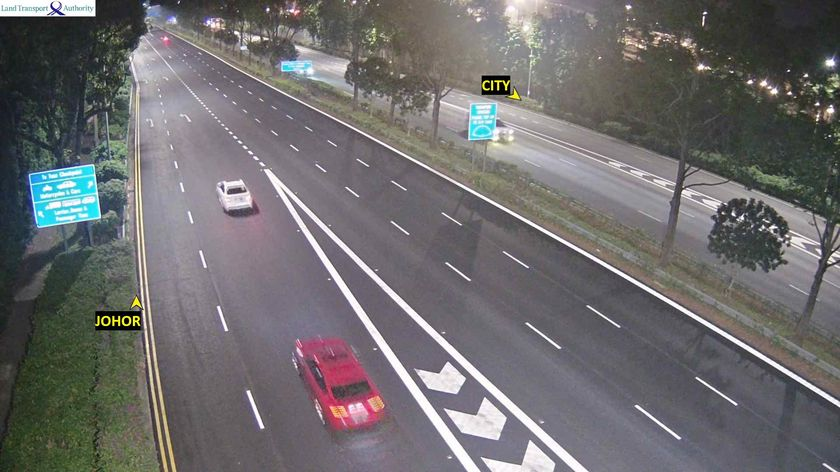
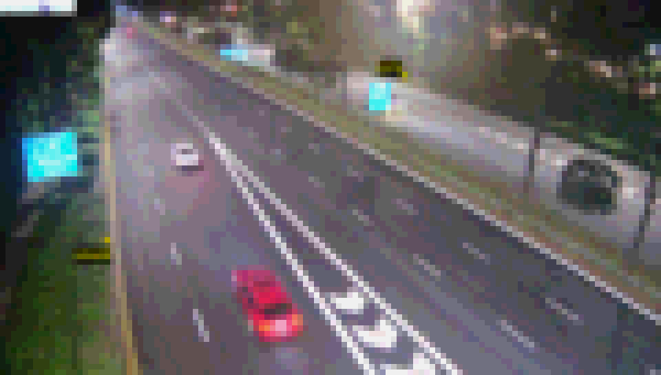
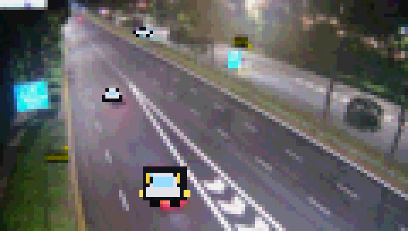
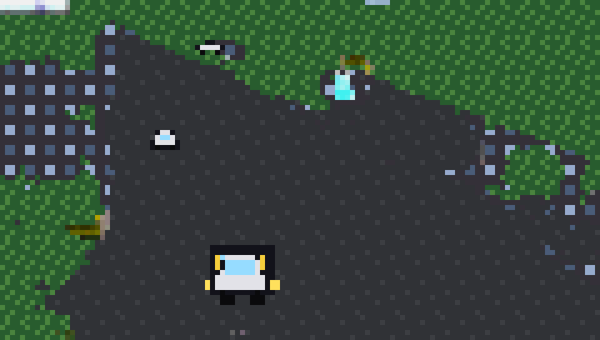

# 📺 sgtraffic

A retro 8-bit terminal viewer for live Singapore traffic-camera feeds. It pulls
snapshots from the [Data.gov.sg](https://data.gov.sg) real-time Traffic Images
API and renders them as TrueColor Unicode half-block art, like a little arcade
CCTV monitor in your shell.

## See it running

One command, no arguments, nothing to look up:

```bash
uv sync && uv run sgtraffic demo
```

That picks whichever camera is live right now, downloads the two ONNX models on
first run (about 28 MB into `~/.cache/sgtraffic/`), and streams the full
"de-make": segmented background regions repainted as pixel-art tiles, with
detected vehicles drawn over them as sprites. From a cold cache it takes about
four seconds to the first frame. Ctrl-C to stop, or add `--once` for a single
frame.

Why a dedicated command? The API only returns cameras that are live this
minute, so any id printed in a README goes stale. `demo` picks for you.

You need a TrueColor terminal. Check with `echo $COLORTERM`, which should say
`truecolor`.

## What it looks like

One frame from camera 4712 (AYE towards Tuas), captured at 00:20 SGT and put
through each stage. All four come from the same fetch, so they are the same
moment.

| Original camera frame | `view 4712`, plain pixel art |
| --- | --- |
|  |  |

| `-d`, vehicles as sprites | `-d -s`, the full de-make |
| --- | --- |
|  |  |

In the `-d` frame the two cars have been replaced by drawn sprites: a chunky
white one in the foreground with yellow headlights, and a smaller one further
up the road. Note that sprite color is picked from the box position, not from
the car's actual paint, which is why the red car comes back white. That is
deliberate, so a jam doesn't render as a row of identical clones.

In the `-d -s` frame the photo is gone entirely. Every background pixel has
been classified and repainted with a tile: dark road, green verges, the
blue-windowed building texture on the right.

### The assets

Every sprite and tile is defined in code as a character grid plus a palette,
so there are no binary assets in the repo. Three car colors, two buses, a
motorbike and a person (`sprites.py`):


Five background textures, each tiled across whatever region the segmenter
labels (`tiles.py`): road, sidewalk, building, greenery, sky.


### Seeing the sprites at a decent size

Sprites are drawn into the same small buffer as everything else, so how big
they look depends entirely on how many character cells you have. In an 80x24
terminal the buffer is about 57x32 pixels and a car covers 2 to 3 of them,
which reads as a smudge rather than a car. Two things help:

- **Give it room.** Maximise the window and drop the font size. The render
  caps at 120 columns, which is where the examples above were made, and a
  foreground car then lands around 16 pixels wide.
- **Pick a camera with close traffic.** A car 40 pixels wide in a 1920-pixel
  frame is 2.5 pixels at 120 columns no matter what you do. Checkpoint and
  flyover cameras frame vehicles much larger than the long expressway views.
  `uv run sgtraffic list` shows what is live.

Regenerate these images with
`uv run python scripts/make_example_images.py <camera_id>`. Camera frames
update every minute or so, so you will get a different scene.

Camera images come from the [Data.gov.sg](https://data.gov.sg) Traffic Images
API (Land Transport Authority) and are reproduced here under the Singapore Open
Data Licence.

## Commands

```bash
uv run sgtraffic                    # interactive menu (the default)
uv run sgtraffic list               # every live camera, grouped by expressway
uv run sgtraffic demo               # auto-picked camera, full de-make
uv run sgtraffic view 2702          # one snapshot from a specific camera
uv run sgtraffic view 6710 -r 20    # live monitor, new frame every 20s
uv run sgtraffic view 2705 -d       # vehicle sprites + congestion score
uv run sgtraffic view 2705 -d -s    # full de-make: tiles + sprites
```

`python -m sgtraffic` works too. Run `list` first if you want a real camera id,
since the live set changes through the day.

## Detection and congestion score (`--detect`)

`--detect` (`-d`) runs object detection over each snapshot, redraws the vehicles
it finds as hand-made pixel-art sprites stamped over the photo, and prints a
congestion score:

```text
CONGESTION [█████░░░░░░░░░░░]  30% MODERATE  car:2 bus:1 bike:1 ped:1
```

**Detector.** A small YOLOv8n model run through
[ONNX Runtime](https://onnxruntime.ai), mapping COCO classes onto car,
bus/truck, motorbike/bicycle and person. The only dependency is `onnxruntime`
(MIT), never the AGPL `ultralytics` package. Weights are fetched at runtime and
never committed. See [ADR 0001](docs/adr/0001-onnxruntime-not-ultralytics.md).

**Sprites.** Defined in code (`sprites.py`) as character grids plus a palette,
with no binary assets. Cars come in a few colors so a jam doesn't look like
clones.

**Score.** Blends vehicle count with box occupancy, a density proxy that keeps
near and far cameras roughly comparable, into a 0-100 value bucketed
QUIET → MODERATE → BUSY → JAM. Tune the detector with `--conf`.

```bash
uv run sgtraffic view 2705 -d --conf 0.3        # single analyzed frame
uv run sgtraffic view 2705 -d -r 20             # live analyzed monitor
uv run sgtraffic view 2705 -d --model yolo.onnx # bring your own weights
```

## Background de-make (`--segment`)

`--segment` (`-s`) goes further than sprites over a photo. It runs semantic
segmentation to label every background pixel (road, sidewalk, building,
greenery, sky) and repaints each region with a matching pixel-art tile, turning
the scene into an 8-bit reinterpretation. Combine it with `--detect` for the
full effect.

**Segmenter.** A small SegFormer-B0 trained on Cityscapes, again through ONNX
Runtime with the same MIT-only dependency story.

**Tiles.** Code-defined in `tiles.py` (character grid plus palette, no binary
assets), tiled across each segmented region without visible seams.

```bash
uv run sgtraffic view 2705 -s          # tiled background only
uv run sgtraffic view 2705 -d -s       # full de-make
uv run sgtraffic view 2705 -d -s -r 20 # live de-make monitor
```

## Where the models come from

Both models download on first use and cache in `~/.cache/sgtraffic/`. Each
source is pinned twice: the URL points at a specific `/resolve/<commit-sha>/`
revision rather than a branch, and the SHA-256 of the bytes at that revision is
recorded alongside it. The download is hashed while streaming and checked
before the file is moved into place, so a bad copy never lands in the cache. The
cache is re-verified on every run.

This is not paranoia for its own sake. Both original default URLs were deleted
from Hugging Face and started returning `401`, which silently killed `--detect`
and `--segment` on every cold cache. Each module now carries a list of mirrors
tried in order, and `tests/integration/test_model_sources.py` is the thing that
notices when one dies.

If a digest ever mismatches, the cached file is deleted and you get an error
that says so explicitly, because a tampered or truncated file needs a different
response from a flaky network.

To use your own weights, pass `--model` / `--seg-model` or set
`SGTRAFFIC_MODEL` / `SGTRAFFIC_SEG_MODEL` (a path) or `SGTRAFFIC_MODEL_URL` /
`SGTRAFFIC_SEG_MODEL_URL` (a single source). Your own model is never checked
against our digest, since you deliberately asked for different weights. To
export one yourself: `YOLO("yolov8n.pt").export(format="onnx")` in a throwaway
environment with `ultralytics` installed.

## How the image engine works

Each terminal cell renders two vertical pixels using the lower-half-block glyph
`▄`. The cell background is the top pixel and the foreground (the glyph itself)
is the bottom pixel, which doubles vertical resolution and keeps pixels square.

- **TrueColor** `38;2;R;G;B` and `48;2;R;G;B` escapes give 16.7M colors.
- **Posterization** (`--bits`, default 4) collapses each channel to a few
  levels for chunky retro banding, with a saturation and contrast nudge to
  make it pop.
- **Run-length optimization**: identical adjacent cells reuse the previous SGR
  instead of re-emitting it. A flat row of sky costs 2 escape sequences instead
  of 41. This is why the raster bypasses Rich entirely, and it is guarded by
  escape-count tests. See [ADR 0002](docs/adr/0002-raw-ansi-raster-not-rich.md).
- **Resize-safe**: target dimensions are recomputed from the live terminal size
  every frame, so the art always fits the window and never wraps. The budget is
  allowed to shrink to a single cell rather than clamp upward, because a wrapped
  line shears every row beneath it.

## Working on it

```bash
uv sync                               # create the venv, install everything
git config core.hooksPath .githooks   # enable the pre-push gate (once per clone)
```

The hook runs lint, format, type-check and the fast tests before every push, so
a push rarely lands red. It takes about a second. Bypass it with
`git push --no-verify` if you genuinely need to.

The same four checks, which are worth running before you commit:

```bash
uvx ruff@0.16.1 check src tests scripts
uvx ruff@0.16.1 format --check src tests scripts
uvx ty@0.0.65 check src
uv run pytest
```

Pin those tool versions. A bare `uvx ruff` floats to the latest release and
enables rules CI has never run, so your local gate starts disagreeing with CI.
The pins live in three places (the commands above, `.githooks/pre-push` and
`.github/workflows/ci.yml`) and move together in one commit.

`main` is protected: no direct pushes, no force pushes, and a PR needs
`lint + type-check` and `pytest (offline)` green before it can merge. Branch per
change, open a PR, let CI run. Two further CI jobs, `pip-audit` and the
integration suite, are advisory and report into the job summary without blocking
anything.

## Tests

Two layers, split by cost.

```bash
uv run pytest                  # fast: 150 tests, offline, under a second
uv run pytest -m integration   # heavy: 27 tests, real weights + live API
```

The fast layer is the default and the only thing the pre-push hook runs. It uses
synthetic images, synthetic tensors and a fake ONNX session, so it proves the
maths but can say nothing about the real models. It must stay this quick: the
moment a push gate needs the network, people learn to reach for `--no-verify`.

The heavy layer lives in `tests/integration/` and is deselected unless you ask
for it. It downloads the actual weights, builds real ONNX Runtime sessions,
checks the real tensor shapes and digests, and runs a live camera frame through
both pipelines end to end. Anything it needs and cannot reach (a dead mirror, no
internet, the API being down) makes it skip rather than fail, so the suite still
runs offline. In CI it is advisory, on a weekly schedule and manual dispatch.

The split is written up in [ADR 0003](docs/adr/0003-two-test-layers.md).

## Layout

| Module          | Responsibility                                            |
| --------------- | --------------------------------------------------------- |
| `api.py`        | Data.gov.sg client, `Camera` dataclass, image download    |
| `locations.py`  | camera-id → friendly name / expressway mapping            |
| `render.py`     | image → colored half-block art + CRT framing (the engine) |
| `detect.py`     | YOLOv8n via ONNX Runtime → vehicle/person detections      |
| `sprites.py`    | code-defined pixel-art sprites, stamped over the photo    |
| `congestion.py` | count + occupancy → 0-100 congestion score                |
| `segment.py`    | SegFormer via ONNX Runtime → per-pixel background classes |
| `tiles.py`      | code-defined tileable textures, painted over regions      |
| `cli.py`        | Typer commands, interactive menu, auto-refresh loop       |

## Design decisions

The choices that look arbitrary until you know why (ONNX Runtime instead of
`ultralytics`, printing the raster raw instead of through Rich, the two test
layers) are written up as short ADRs in [`docs/adr/`](docs/adr/README.md).
